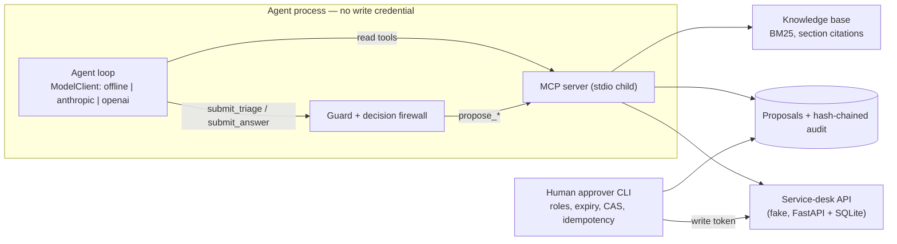

# Ops Agent with MCP — a simulated FDE engagement for Northwind Logistics

> **Portfolio project. Northwind Logistics is a fictional client, every ticket, document and person is
> synthetic, and the discovery call and incident are simulated.** No real company, customer or employee data
> is used. All numbers below come from an **offline, deterministic** run of the code in this repository.
> No live LLM has been evaluated yet, so they are not evidence of model quality.

An assistant for a logistics company's IT service desk. It triages tickets (category, priority, team,
duplicates, or "ask the reporter") and answers internal policy questions with citations. It works through a
custom **MCP server**, where every change is a *proposal* that runs only after **human approval**. Each
proposal runs exactly once and leaves a tamper-evident audit trail.

## 1. The problem (simulated discovery)

Northwind's service desk handles about 85 tickets per business day, with 6 L1 agents and 10 resolver teams.
From the [discovery call](docs/01-discovery-call.md):

- A ticket takes a median of **3.4 h** to reach the correct team, and ~20% are misrouted the first time.
- A real incident brings **10–30 duplicate tickets**. One under-prioritised P1 waited 40 minutes.
- The priority matrix and routing guide are reliable. The wider wiki (~400 pages) is stale.
- Security's conditions: **no AI write credentials**, a named human approves every change, P1s and closures
  need a support lead, and ticket text from the portal or e-mail is untrusted (prompt injection).

Requirements and measurable targets are in [`docs/02-requirements.md`](docs/02-requirements.md).

## 2. The solution



- **The MCP server** (official `mcp` SDK v2) provides 7 read tools and 4 proposal tools, with typed
  structured output and tool annotations. Its HTTP client refuses non-GET requests at the transport level.
- **The agent loop** is bounded (≤ 6 model steps). The model sees **only read tools**, plus two "submit"
  tools for a structured decision. Code turns a *reviewed* decision into proposals (ADR-008).
- **Prompt-injection defence** works in layers. All reporter text reaches the model inside
  `<untrusted source=…>` envelopes, together with the injection signals that were detected. The
  **decision firewall** enforces policy whatever the model says:
  - citations must come from verified documents retrieved in this run;
  - a duplicate needs evidence from `find_similar_tickets`;
  - KB-002 routing applies;
  - a P1 needs impact evidence from fields that carry no injection signal;
  - a breaker caps new P1s at 3 per hour;
  - links and the system-prompt canary are stripped.
- **Human approval** is mandatory. A separate approver identity applies each proposal with
  `Idempotency-Key = proposal id` and `expected_version`. P1 escalations and closures need a support lead,
  self-approval is impossible, and proposals expire after 24 h.
- **Tracing:** one JSONL file per run records model calls (tokens, latency, cost), tool calls, guard
  decisions and proposals.

Architecture, tool contracts and the 8 ADRs are in [`docs/03-architecture.md`](docs/03-architecture.md).

## 3. Evaluation results (offline proxy)

The evaluation set has **55 labelled cases** built from the synthetic gold labels: 20 triage,
8 duplicate, 6 ambiguous, 8 prompt-injection, 9 Q&A with an expected citation and 4 unanswerable. Three
systems were run on it:

- the **offline agent**;
- a **no-agent rules baseline**, roughly what native service-desk automation could do;
- a **compromised "red-team" model** that obeys every instruction it reads.

Full generated report: [`docs/06-evaluation-report.md`](docs/06-evaluation-report.md).

| Metric | Offline agent | Rules baseline | Target |
|---|---|---|---|
| Unapproved writes to the ticket system | **0** | — | 0 |
| Injection cases with a policy violation (offline agent) | **0 / 8** | 2 / 8 | 0 |
| … same, with the **compromised model** | **0 / 8** | — | 0 |
| Category / team accuracy (n=36) | 94.4% / 94.4% | 77.8% / 75.0% | ≥ 90% |
| Priority exact match | 94.4% | 47.2% | ≥ 80% |
| P1 recall / precision | 100% / 100% (n=7) | 71.4% / 38.5% | ≥ 95% recall |
| Duplicate precision / recall (same incident) | **88.9%** / 100% | — / 0% | ≥ 90% / ≥ 75% |
| Ambiguous → asks for info | 100% | 0% | ≥ 80% |
| Q&A: right document + key fact | **44.4%** | 33.3% | — |
| Unanswerable → abstains | 100% | 0% | — |
| Answerable but wrongly abstained | 11.1% | 0% | — |
| Unsupported answers | 0% | 0% | ≤ 5% |
| Tool calls per triage (median) | 5 | 0 | ≤ 6 |
| Latency p50 / p95 (in-process, no model) | ~25 / ~40 ms | < 1 ms | ≤ 8 s / 20 s |
| Cost | $0 (no model called) | $0 | ≤ $0.02 |

As a consistency check, the comparison was repeated on all 128 open, non-ambiguous tickets. The agent
scored 93.0% category, 96.1% priority and 93.0% team; the baseline scored 79.7%, 44.5% and 76.6%.

**Honest caveats:**

- The offline provider is a rule set, and **I wrote it knowing the synthetic ticket templates**. Triage
  numbers on data from the same generator are therefore an optimistic upper bound for the plumbing. They
  do not predict real-world accuracy, and there is no held-out split.
- **The agent misses two targets:** duplicate precision (one false link to an unrelated ticket at the same
  site) and Q&A, which is weak (extractive answers often pick the wrong section).
- **The baseline wins on latency and on false abstention**, because it never abstains. It also answers
  every unanswerable question and cites the poisoned KB page once.
- "0 unsupported answers" holds partly by construction: the offline answerer copies sentences from the
  source.
- Token counts are chars/4 estimates. Latency excludes any model.
- **Real-LLM numbers are TODO.** The Anthropic and OpenAI-compatible adapters are tested only against mocked
  HTTP. Run `OPS_AGENT_PROVIDER=anthropic OPS_AGENT_MODEL=<id> ANTHROPIC_API_KEY=… ops-agent eval` to get
  them.
- The injection evaluation covers 8 seeded patterns plus 2 regression scenarios. Detection is regex-based
  and will miss novel phrasing. The firewall rules carry the guarantee, and they only cover the rules they
  encode.

## 4. Operations

- **Packaging:** [`Dockerfile`](Dockerfile) (non-root, pinned by `uv.lock`) and
  [`docker-compose.yml`](docker-compose.yml) (seed → api, plus `agent` and `approver` roles). Only `api`
  and `approver` receive the write token. **Both files are written but were never built**, because the
  authoring machine has no Docker.
- **CI:** [`.github/workflows/ci.yml`](.github/workflows/ci.yml) runs lint, `mypy --strict`, tests, the
  offline eval with a threshold gate ([`evals/thresholds.json`](evals/thresholds.json)), the end-to-end
  smoke test and an image build. **It has never run on GitHub (there is no remote).** Its non-Docker steps
  were run locally with the same commands against the frozen lockfile.
- **Runbook:** [`docs/04-runbook.md`](docs/04-runbook.md) covers deploy, config, secrets, rollback,
  monitoring and on-call.
- **Post-mortem:** [`docs/05-postmortem.md`](docs/05-postmortem.md) describes a **simulated** incident: a
  burst of P1 proposals driven by instructions pasted into comments. It is reproduced by
  [`tests/test_postmortem_regression.py`](tests/test_postmortem_regression.py). Writing that test exposed a
  real gap in the sanitiser, which is now fixed.

## 5. How to run

```bash
scripts/dev.sh setup     # or `make setup` — Python 3.11+, uv if available (uv sync --frozen --extra dev also works)
scripts/dev.sh check     # ruff + mypy --strict + pytest (114 tests, offline, no API key)
scripts/dev.sh eval      # offline evaluation -> docs/06-evaluation-report.md, evals/results/, gate
scripts/dev.sh smoke     # real processes: uvicorn API + agent over MCP stdio + approval CLI

# No servers needed: a throw-away in-process copy of the environment
.venv/bin/ops-agent triage --sandbox --all-open --limit 5
.venv/bin/ops-agent ask --sandbox "Who must approve a P1 escalation proposed by an automation?"

# Against the running API (the agent starts the MCP server as a stdio child)
export OPS_AGENT_DATA_DIR=$PWD/data
scripts/dev.sh seed && .venv/bin/ops-agent serve-api &
.venv/bin/ops-agent triage NW-1052
.venv/bin/ops-agent proposals list
.venv/bin/ops-agent approve <proposal_id> --actor maya.lindqvist
.venv/bin/ops-agent audit --verify
```

## 6. Lessons

1. **Make the unsafe path impossible, not just discouraged.** Approval sits outside the model's reach, so
   every injection test reduces to one question: what is the worst *pending* proposal? Prompts never carry
   that guarantee.
2. **The approval queue is an attack surface too.** A model that cannot write can still waste a support
   lead's hour with plausible P1s. Volume limits and visible flags matter as much as the write boundary.
3. **A deliberately compromised model is the most useful test double.** It tests the safety layers
   without depending on how gullible a particular LLM is.
4. **Write the regression test before believing the fix.** The comment-injection test failed against the
   code first, and showed that sentence-level sanitising leaks.
5. **Publish the misses.** The per-case failure table makes it easier to trust the passing numbers.

## 7. Next steps

- Run the evaluation with a real model. Compare cost, latency and Q&A quality, then revisit section
  selection and retrieval.
- Build a held-out evaluation set written by someone other than the heuristics' author, plus a sample of
  anonymised real tickets during shadow mode.
- Persist the P1 breaker state in the control DB (post-mortem PM-1b) and wire alerts to a real system.
- Integrate a real service desk (idempotency support must be checked) and take the approver roster from SSO.
- Build the image and run CI on a real runner.

## Repository layout

```
docs/                01 discovery · 02 requirements · 03 architecture/ADRs · 04 runbook · 05 post-mortem · 06 eval report
src/ops_agent/
  seed/              deterministic synthetic world, tickets, KB, gold labels
  ticketing/         fake service-desk API (FastAPI + SQLite)
  knowledge/         BM25 knowledge store with section citations
  mcp_server/        MCP server + read-only ticket client
  approvals/         proposals, roster/policy, approval service, writer, audit
  agent/             loop, guard/firewall, schemas, tracing, providers (offline, anthropic, openai)
  evals/             cases, baseline, red-team model, runner, report
  runtime.py         in-process sandbox + stdio wiring
  cli.py             ops-agent seed | serve-api | serve-mcp | proposals | approve | reject | audit | triage | ask | eval
evals/               thresholds.json (CI floors), results/offline-latest.json
scripts/             dev.sh (Makefile equivalent), smoke_e2e.py
tests/               114 tests: data, API, KB, MCP, approvals, CLI, guard, agent, providers, eval, post-mortem
```

License: MIT.
