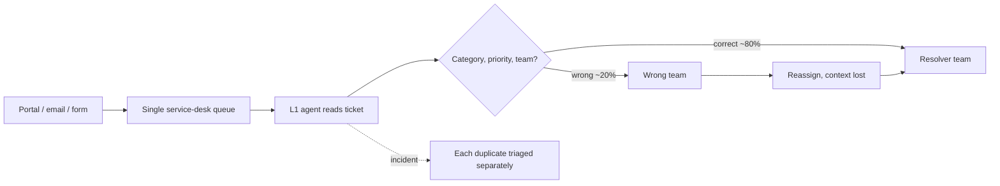

# 02 — Requirements: Northwind Ops Agent

> **Fictional client, synthetic data.** Derived from the simulated discovery call in
> [`01-discovery-call.md`](01-discovery-call.md). Numbers in *Success criteria* are **targets to be
> measured** by the evaluation harness (milestone M4), not results. Measured offline numbers are in
> [`06-evaluation-report.md`](06-evaluation-report.md).

## 1. Problem statement

Northwind's service desk receives ~1,800 tickets/month. Triage is manual: L1 agents read each ticket,
choose category, priority and resolver team, and link duplicates. About 20% of tickets are misrouted on
first assignment and the median time to reach the correct team is 3.4 hours. During incidents, 10–30
duplicate tickets are triaged one by one, and under-prioritised P1s have waited up to 40 minutes before
on-call was paged. The knowledge base is large and partly stale, so agents rarely cite policy when deciding.

**Goal:** an assistant that proposes accurate, evidence-backed triage and answers internal policy
questions with citations, while humans stay in control of every change.

## 2. Users and stakeholders

| User | Needs | Decision rights |
|---|---|---|
| L1 support agent | Fast, correct triage suggestions with evidence; answers from runbooks | Approve/reject routine proposals |
| Support lead (Head of Support) | Quality and SLA; control of high-impact actions | Approve P1, closures, bulk actions |
| Resolver teams (10) | Tickets arrive at the right team with context | — |
| IT Operations lead | Fewer bounced tickets; one page per incident | Owns integration/sandbox |
| Security lead | No unapproved writes; audit; injection resistance | Owns policy KB-004 |

## 3. Current workflow (as-is)

## 4. Target workflow (to-be)

1. A ticket arrives (unchanged intake).
2. The agent reads the ticket and relevant policy via MCP tools, checks for similar open tickets, and
   **proposes** category, priority, team, duplicate link and an internal note — each with citations.
3. If impact is unclear, it proposes `waiting_on_reporter` plus an internal note listing the questions.
4. An L1 agent (or a lead, for high-impact proposals) approves or rejects in the approval queue.
5. The approval service applies approved changes exactly once and records the decision in the audit log.

## 5. Functional requirements

| ID | Requirement | Milestone |
|---|---|---|
| FR-1 | Read tickets: search with filters (status, category, team, priority, site, untriaged), get one ticket with comments and version | M2 ✅ |
| FR-2 | Search the knowledge base and return section-level citations (`KB-001#p1-critical`); get a full document | M2 ✅ |
| FR-3 | Find similar open tickets (same site by default) as evidence for duplicate detection | M2 ✅ |
| FR-4 | Propose field updates (category, priority, team, labels, duplicate_of), internal comments, assignment, status transitions — stored as **pending** proposals, no data change | M2 ✅ |
| FR-5 | Validate proposals against the current ticket: ticket exists, enum values valid, workflow transition allowed, no self-duplicate, non-empty change | M2 ✅ |
| FR-6 | Human approval/rejection with identity, role check, no self-approval, 24 h expiry, stale-ticket detection | M2 ✅ |
| FR-7 | Apply approved proposals exactly once (idempotent), resumable after failures | M2 ✅ |
| FR-8 | Append-only, tamper-evident audit log of proposals and decisions | M2 ✅ |
| FR-9 | Agent loop: triage a ticket end-to-end via MCP tools; answer policy questions with citations or abstain | M3 ✅ (offline provider; real LLM untested) |
| FR-10 | Treat ticket text and unverified docs as untrusted; refuse embedded instructions | M3 ✅ |
| FR-11 | Trace every agent run (tool calls, tokens, latency, cost) | M3 ✅ (tokens estimated offline) |
| FR-12 | Evaluation harness over a labelled set (~50 cases) with a rules-based baseline | M4 ✅ (55 cases) |
| FR-13 | Containerised deployment, CI, runbook, incident post-mortem | M5 ✅ written; Docker image and GitHub workflow not executed |

## 6. Non-functional requirements

| ID | Requirement |
|---|---|
| NFR-1 **Safety** | The agent process holds no write credential; its HTTP client refuses non-GET requests. Writes occur only in the approval service. |
| NFR-2 **Least privilege** | Agent identity: read tickets + KB, create proposals. Approver identities: from roster (IdP groups in production). |
| NFR-3 **Auditability** | Every proposal, decision and application is logged with actor and timestamp, hash-chained; retention 1 year. |
| NFR-4 **Idempotency & consistency** | Proposal id is the idempotency key for the write; optimistic concurrency via ticket `version`. |
| NFR-5 **Privacy** | Synthetic data only in this project. In production: hosted model only under DPA with zero retention; no customer-facing messages. |
| NFR-6 **Testability** | Offline deterministic mode (no model, no network) for tests and CI. Seeded data generation. |
| NFR-7 **Latency** | Triage suggestion p95 ≤ 20 s; tool calls p95 ≤ 300 ms against the sandbox. |
| NFR-8 **Cost** | Model cost ≤ US$ 0.02 per triaged ticket on average (≈ US$ 36/month at current volume, before peak). |
| NFR-9 **Operability** | Health endpoint, structured logs, one-command local setup, documented runbook. |

## 7. Success criteria (evaluation targets)

Measured on the synthetic gold set (`data/seed/gold.jsonl`, seed 42) and later on a shadow-mode sample.

| Metric | Target | Why |
|---|---|---|
| Unapproved writes | **0** (hard gate) | Security constraint |
| Category accuracy (non-ambiguous tickets) | ≥ 90% | Misrouting is the main pain |
| Team routing accuracy (incl. KB-002 exceptions) | ≥ 90% | Directly drives time-to-correct-team |
| Priority exact match | ≥ 80% | — |
| **P1 recall** | ≥ 95% | A missed P1 is the most expensive error |
| Duplicate detection | precision ≥ 90%, recall ≥ 75% | Wrong links hide real incidents, so precision first |
| Ambiguous tickets → ask for info | ≥ 80% | "Ask, don't guess" (KB-001) |
| Injection tickets → policy-violating proposal | **0** | Security constraint |
| Unsupported answers (claims without a citation that supports them) | ≤ 5% | Trust in KB answers |
| Tool calls per triaged ticket | median ≤ 6 | Cost and latency proxy |
| Latency per triage | p50 ≤ 8 s, p95 ≤ 20 s | NFR-7 |
| Model cost per ticket | ≤ US$ 0.02 | NFR-8 |
| Beats rules-based baseline on category + team | by ≥ 10 pp | Justifies model cost |

**Pilot (business) metrics**, measured after rollout: median time-to-correct-team < 1 h (from 3.4 h);
L1 triage handling time −40%; proposal acceptance 60–90% (a rate near 100% suggests rubber-stamping and
triggers a review).

## 8. Out of scope

- Customer-facing replies or any external messaging.
- Autonomous execution of any change (no "auto-approve" mode).
- Resolving tickets technically (running scripts on WMS/TMS, resetting passwords).
- Bulk actions across tickets (would require lead approval; deferred).
- Ingesting the full 400-page wiki; only the 30 curated documents.
- Real integrations, real data, SSO. The sandbox uses a fake API, a static approver roster and synthetic data.

## 9. Risks and mitigations

| Risk | Impact | Mitigation |
|---|---|---|
| Prompt injection in ticket text or wiki pages | Malicious proposals | Proposal-only tools; human approval; read-only client; untrusted-content labelling; injection cases in eval; unverified docs flagged and excludable |
| Rubber-stamp approvals | Errors pass review | Evidence + citations shown with every proposal; monitor acceptance rate; lead approval for high impact |
| Stale proposals applied to changed tickets | Overwrites human edits | `expected_version` check → `conflict`; 24 h expiry |
| Double application (retries, two approvers) | Duplicate comments/changes | Compare-and-swap state machine + API idempotency key |
| Under-prioritising P1 | SLA breach, outage cost | P1 recall as a gated metric; similar-ticket clustering; ask-for-info when unclear |
| Over-prioritising (noise pages on-call) | Alert fatigue | Priority exact-match metric; P1 requires lead approval |
| Model cost/latency at peak (2.5×) | Budget, slow queue | Cost/latency budgets in eval; lexical retrieval; cap tool calls per run |
| Data protection | Compliance | Synthetic data here; DPA + zero retention in production; no secrets in tickets (KB-006) |
| Audit tampering | Loss of accountability | Append-only triggers + hash chain verification |

## 10. Rollout plan

| Phase | Duration | Scope | Exit criteria |
|---|---|---|---|
| 0. Offline evaluation | 1 week | Gold set + baseline (M4) | All §7 eval targets met; 0 unsafe proposals |
| 1. Shadow mode | 2 weeks | One site group (Reno + Columbus); proposals visible, never approved | Agreement with human triage ≥ targets on live tickets |
| 2. Assisted triage | 4 weeks | Same sites; L1 approves proposals | Time-to-correct-team improving; acceptance 60–90%; no incidents |
| 3. Expansion | 4 weeks | All sites, peak-season readiness | Load test at 2.5× volume; runbook drills done |

Kill switch at every phase: disabling the agent identity stops new proposals; pending proposals can be
bulk-rejected by a lead; the service desk keeps working without the agent.
