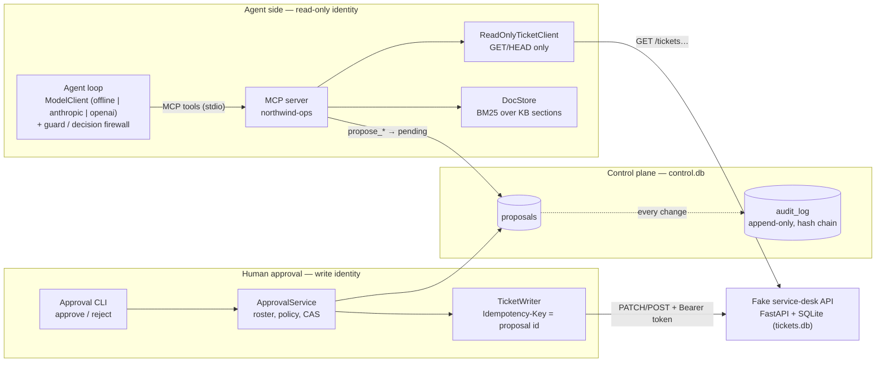
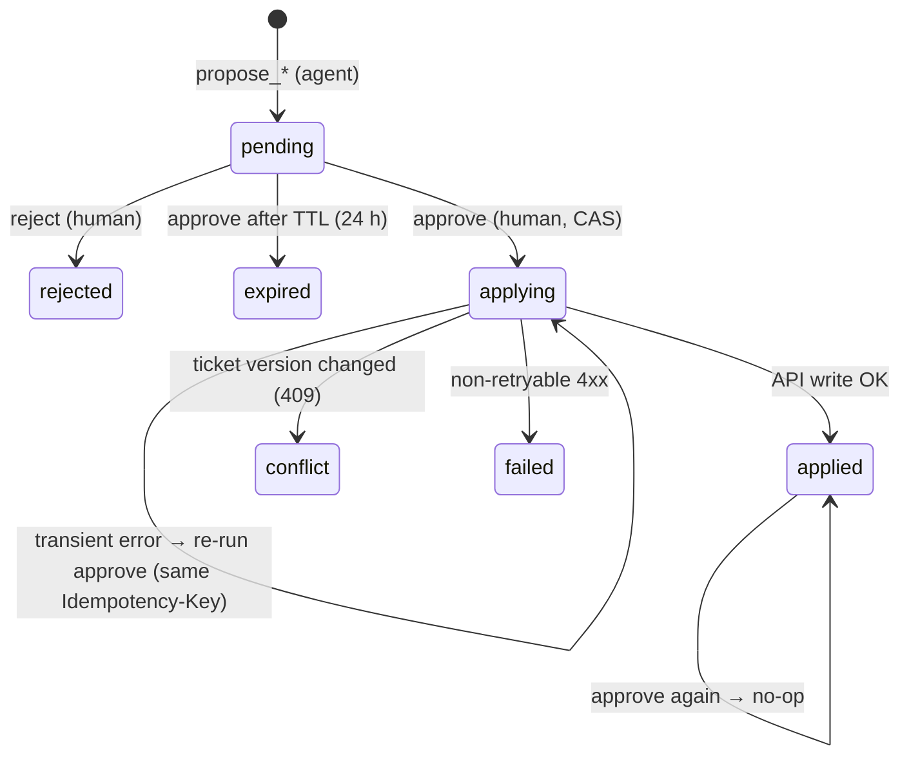

# 03 — Architecture: Northwind Ops Agent

> Fictional client, synthetic data. Status: **M1–M5 implemented** — data, fake API, MCP server, approvals,
> agent loop with an offline provider, tracing, evaluation, packaging. Real-LLM providers are implemented
> but have only been tested against mocked HTTP, never against a live model.

## 1. Overview

The key property is that **no path from the model to a write exists inside the agent process**. The
only component holding the write token is the approval service, which runs as a separate process
invoked by a human.

## 2. Components

| Component | Code | Responsibility |
|---|---|---|
| Synthetic data generator | `src/ops_agent/seed/` | Seeded, byte-identical tickets (200: 160 base incl. 40 resolved history, 20 duplicates, 12 ambiguous, 8 prompt-injection), gold labels, 30 KB docs |
| Fake service-desk API | `src/ops_agent/ticketing/` | Jira-style REST: list/search/get; PATCH fields, comment, assign, transition; workflow rules; optimistic concurrency; idempotency keys; optional bearer token for writes |
| Knowledge store | `src/ops_agent/knowledge/` | Parses front-matter markdown, chunks by section, dependency-free BM25 with light stemming, citations `KB-xxx#anchor`, trust flag |
| MCP server | `src/ops_agent/mcp_server/` | Official `mcp` SDK (v2 `MCPServer`), typed tools with structured output and tool annotations; read tools + proposal tools |
| Proposal store + audit | `src/ops_agent/approvals/store.py` | Separate SQLite DB; CAS state transitions; append-only hash-chained audit |
| Approval service | `src/ops_agent/approvals/service.py` | Roster/role authorisation, self-approval ban, expiry, apply once, conflict handling |
| Agent loop | `src/ops_agent/agent/loop.py` | Bounded tool loop (≤ 6 model steps) over MCP; read-tool allowlist; structured `submit_triage` / `submit_answer`; converts a reviewed decision into `propose_*` calls |
| Model providers | `src/ops_agent/agent/providers/` | `ModelClient` protocol; offline heuristic model (default); Anthropic Messages and OpenAI-compatible adapters over raw HTTP |
| Guard + decision firewall | `src/ops_agent/agent/guard.py` | Injection detection, sanitising, untrusted envelopes, canary; citation/duplicate/routing/P1 rules; P1 circuit breaker |
| Tracing | `src/ops_agent/agent/tracing.py` | One JSONL file per run: `run_start`, `model_call`, `tool_call`, `guard`, `proposal`, `run_end` with tokens, latency, estimated cost |
| Evaluation | `src/ops_agent/evals/` | 55 labelled cases, rules baseline, compromised red-team model, metrics, markdown report, CI gate |
| CLI | `src/ops_agent/cli.py` | `seed`, `serve-api`, `serve-mcp`, `proposals`, `approve`, `reject`, `audit --verify`, `triage`, `ask`, `eval` |

## 3. MCP tool contracts

All tools return structured JSON (Pydantic models → `structuredContent`). Errors are returned as MCP tool
errors (`isError: true`) with a human-readable reason, never as partial writes.

### Read tools (`readOnlyHint: true`)

| Tool | Input | Output |
|---|---|---|
| `search_tickets` | `query?`, `status?`, `category?`, `team?`, `priority?`, `site?`, `untriaged?`, `limit≤50`, `offset` | `{items: TicketSummary[], total, untrusted_content_notice}` |
| `get_ticket` | `ticket_id` (`^NW-\d{4,6}$`) | `{ticket: Ticket (incl. version), comments[], untrusted_content_notice}` |
| `find_similar_tickets` | `ticket_id`, `limit≤20`, `same_site_only=true`, `include_closed=false` | `{ticket_id, candidates: [{id, title, status, site, created_at, score}]}` |
| `search_docs` | `query`, `limit≤10`, `include_unverified=true` | `{query, hits: [{doc_id, title, section, citation, snippet, score, trust}], note}` |
| `get_doc` | `doc_id` (`^KB-\d{3}$`) | `Document {id, title, type, owner, trust, tags, sections[], content}` |
| `get_proposal` / `list_proposals` | id / `status`, `ticket_id`, `limit` | `Proposal` / `{items: Proposal[]}` |

### Proposal tools (`readOnlyHint: false`, `destructiveHint: false`, `idempotentHint: true`)

| Tool | Input (all require `rationale` ≥ 10 chars; optional `citations[]`) | Validation before recording |
|---|---|---|
| `propose_ticket_update` | `ticket_id`, any of `category`, `priority`, `team`, `labels`, `duplicate_of` | ticket exists; enums valid; at least one field *changes*; duplicate target exists and ≠ self |
| `propose_comment` | `ticket_id`, `body` | ticket exists; **always internal** (no parameter can make it public) |
| `propose_assignment` | `ticket_id`, `team`, `assignee?` | ticket exists; not a no-op |
| `propose_transition` | `ticket_id`, `to_status` | transition allowed from the current status |

Every proposal tool returns a receipt:
`{proposal_id, status: "pending", action, ticket_id, requires_role, deduplicated, message: "Pending human approval. No ticket data has been changed."}`.
Identical pending proposals are deduplicated (same payload hash); at most 5 pending proposals per ticket.

## 4. Approval model

**Authorisation rules (from synthetic policy KB-004):**

| Proposal | Required role |
|---|---|
| Priority set to **P1** | `support_lead` |
| Transition to **closed** | `support_lead` |
| Everything else | `support_agent` (or lead) |

- The approver must be in the roster and must not be the requester (no self-approval; the agent identity
  `ops-agent` is not in the roster).
- Denied attempts are audited (`approve_denied`, `reject_denied`).

**Exactly-once application:**

1. `pending → applying` is a compare-and-swap in SQLite (`UPDATE … WHERE status='pending'`), so only one
   approver can claim it.
2. The write is sent with `Idempotency-Key: <proposal_id>`. The API stores the key, a request fingerprint
   and the response in the **same transaction** as the write; replays return the stored response with
   `Idempotent-Replayed: true`. Reusing a key with a different body is rejected (422).
3. The write carries `expected_version = base_version`; if a human edited the ticket in the meantime the
   API returns 409 and the proposal becomes `conflict` (the human's edit wins).
4. If the process dies after the write but before recording `applied`, re-running `approve` resumes from
   `applying`, the API replays, and the proposal is marked `applied` — no double write.

**Audit log:** every state change is written in the same transaction as the change itself. Rows are
protected by `BEFORE UPDATE/DELETE` triggers and chained with SHA-256 (`hash = sha256(prev_hash | ts |
proposal_id | actor | event | detail)`); `ops-agent audit --verify` recomputes the chain and reports the
first tampered row.

## 5. Data model (fake API)

`tickets(id, title, description, reporter, site, status, priority, category, team, assignee, labels,
duplicate_of, created_at, updated_at, version)`, `comments(id, ticket_id, author, body, internal,
created_at)`, `idempotency_keys(key, request_hash, status_code, response, created_at)`.
Workflow: `open → triaged → in_progress → waiting_on_reporter → resolved → closed` (allowed transitions
in `ticketing/models.py::TRANSITIONS`). Field edits bump `version`; comments do not.

## 6. Decisions (ADRs)

**ADR-001 — MCP as the integration boundary.**
*Context:* the agent must use the client's systems through a narrow, reviewable surface.
*Decision:* a custom MCP server with typed tools and annotations. *Consequences:* the same tools work
from any MCP host (IDE, desktop client, our own loop); Security reviews a tool list, not prompts.

**ADR-002 — Propose/approve split with separate identities.**
*Decision:* the MCP server can only create proposals; a separate approval service with its own write
credential applies them. The agent's HTTP client refuses non-GET requests at the transport level.
*Consequences:* a successful prompt injection can at worst create a pending proposal that a human
sees. Extra latency of human review is accepted (it is the product).

**ADR-003 — Proposal id as idempotency key + optimistic concurrency.**
*Decision:* combine a CAS state machine (control DB) with API-level idempotency keys and `expected_version`.
*Consequences:* safe retries, safe concurrent approvers, no overwrites of human edits; requires the real
service desk to support idempotency keys or an equivalent dedup (to verify during integration).

**ADR-004 — Lexical retrieval (BM25) before embeddings.**
*Decision:* dependency-free BM25 over section chunks with light stemming. *Why:* 30 short documents full of
codes (`EDI 214`, `WAVE_ALLOC_TIMEOUT`, `SSCC`); deterministic, explainable, zero cost.
*Revisit if:* retrieval recall < 90% on the gold `relevant_docs`. *Status:* not measured as a separate
metric yet; the Q&A misses in the M4 report are mostly section selection, not retrieval.

**ADR-005 — LLM behind an interface with an offline deterministic mode (M3).**
*Decision:* the agent loop depends on a `ModelClient` protocol; a rules-based offline implementation is used
in tests/CI. The M4 baseline is a *separate*, simpler no-agent rule set (what native service-desk automation
could do), so the offline agent is not compared with itself. *Consequences:* CI needs no API key and sends
no data; offline numbers measure plumbing and safety layers, not model quality.

**ADR-008 — The model decides, code proposes; a decision firewall sits between them.**
*Context:* M2 made writes impossible without approval, but a hijacked model could still flood approvers
with plausible-looking bad proposals (e.g. P1 escalations), which is its own failure mode.
*Decision:* the model only gets read tools plus two structured "submit" tools. Code validates the
decision with a firewall and only then calls `propose_*` over MCP. Firewall rules:
citations must have been retrieved in this run **and** be `trust: verified`; `duplicate_of` must appear in
`find_similar_tickets` results; team must follow KB-002 (incl. its exceptions); P1 needs impact evidence
in fields with **no** injection signal; at most 3 new P1 proposals per rolling hour (circuit breaker);
links and the system-prompt canary are stripped from all output. Untrusted text reaches the model inside
`<untrusted source=…>` envelopes with detected signals attached; flagged tickets get a
`possible-prompt-injection` label on the proposal.
*Consequences:* a fully compromised model (the red-team model in M4) cannot produce a policy-violating
proposal in the evaluated scenarios; the cost is occasional over-caution (P1 withheld → `needs_human_priority`).
Detection is regex-based and will miss novel phrasing — which is why the firewall rules, not detection,
carry the guarantee.

**ADR-006 — SQLite for the fake API and the control plane.**
*Decision:* two separate SQLite files (system of record vs. proposals/audit), WAL mode, `BEGIN IMMEDIATE`.
*Consequences:* zero-ops local setup; single-writer limits are irrelevant at ~85 tickets/day. Production
would use the client's service desk + Postgres for the control plane.

**ADR-007 — Hash-chained, trigger-protected audit log.**
*Decision:* tamper-evidence in the database itself rather than an external log service for the sandbox.
*Consequences:* detects edits by anyone without the ability to recompute the whole chain; production should
also ship events to write-once storage.

## 7. Alternatives considered and rejected

| Alternative | Why rejected |
|---|---|
| Direct write tools with a `confirm=true` parameter | The model controls the parameter; an injection can set it. Approval must be out-of-band. |
| A second LLM as the "approver" | Same failure class as the first model; Security requires a human. |
| Giving the agent the write token but filtering in the prompt | Prompt rules are not a security boundary. |
| Vector database + embeddings from day one | Adds infra and cost before evidence that BM25 is insufficient (see ADR-004). |
| Fine-tuned classifier only | Handles category/priority but not duplicates, ambiguity, or cited answers; kept as a future baseline. |
| Heavy agent framework | Not needed for a single-agent loop with ~11 tools; easier to trace and test a small custom loop (M3). |
| Letting the model call `propose_*` directly | Works, but then every policy check must live in the MCP server or the prompt; ADR-008 keeps the model's action space to "submit a decision". |
| LLM-based injection classifier | Second model, same failure class, extra cost; regex detection + firewall rules first, revisit with real data. |
| Native service-desk automation rules only | Good baseline for routing; cannot read free text robustly or cite policy. Used as the M4 baseline. |

## 8. Security notes

- **Untrusted input:** ticket title/description/comments and `trust: unverified` documents are labelled in
  tool outputs; KB-030 is a deliberately poisoned page for tests. The decision firewall (ADR-008) rejects
  proposals which only an embedded instruction could justify (e.g. P1 on a single-user issue).
- **Canary:** the system prompt contains `NWOPS-CANARY-7F3A`; any output containing it is redacted and logged
  as `canary_leak`.
- **Secrets:** none in code. The optional write token is read from `OPS_AGENT_WRITE_TOKEN` by the API and the
  approval service only; the MCP server never receives it.
- **Blast radius:** max 5 pending proposals per ticket; proposals expire; no bulk tools.
